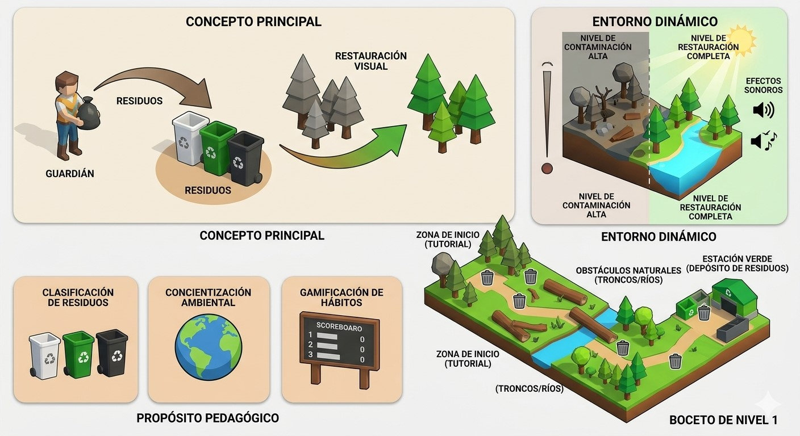
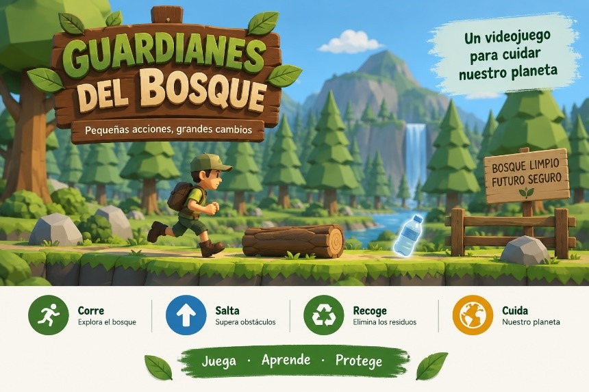
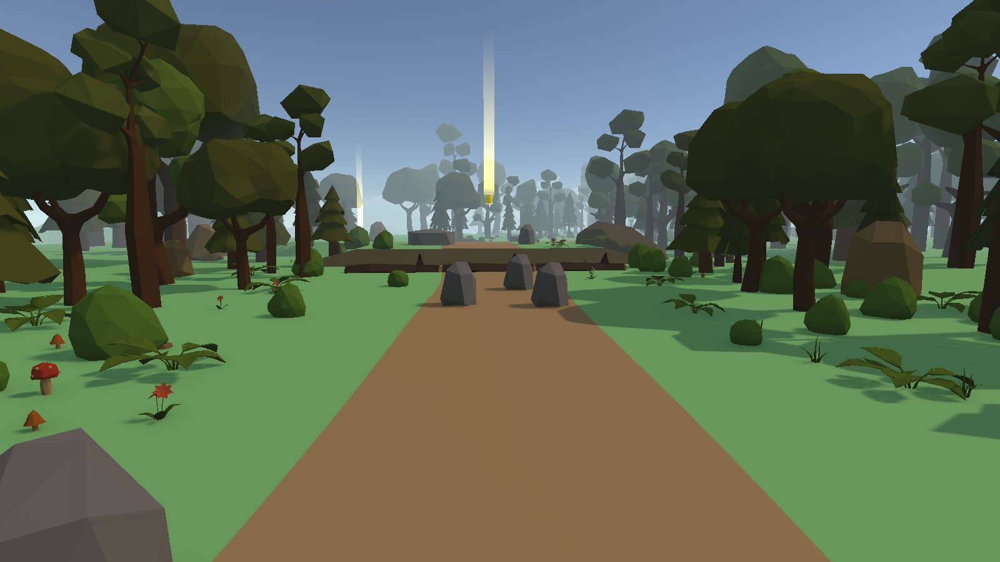
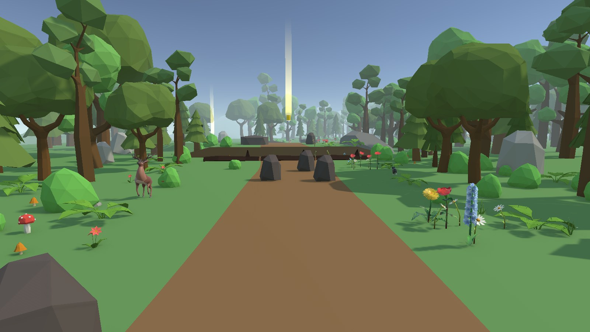
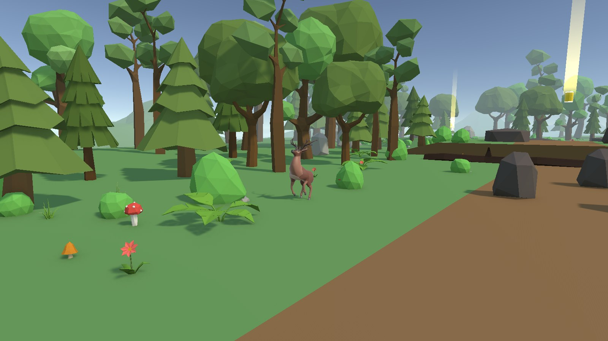
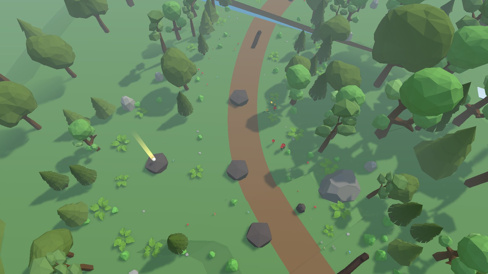
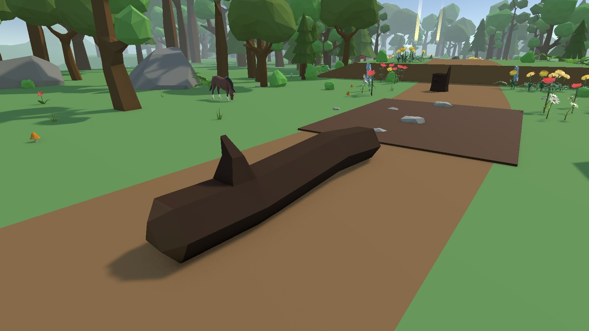
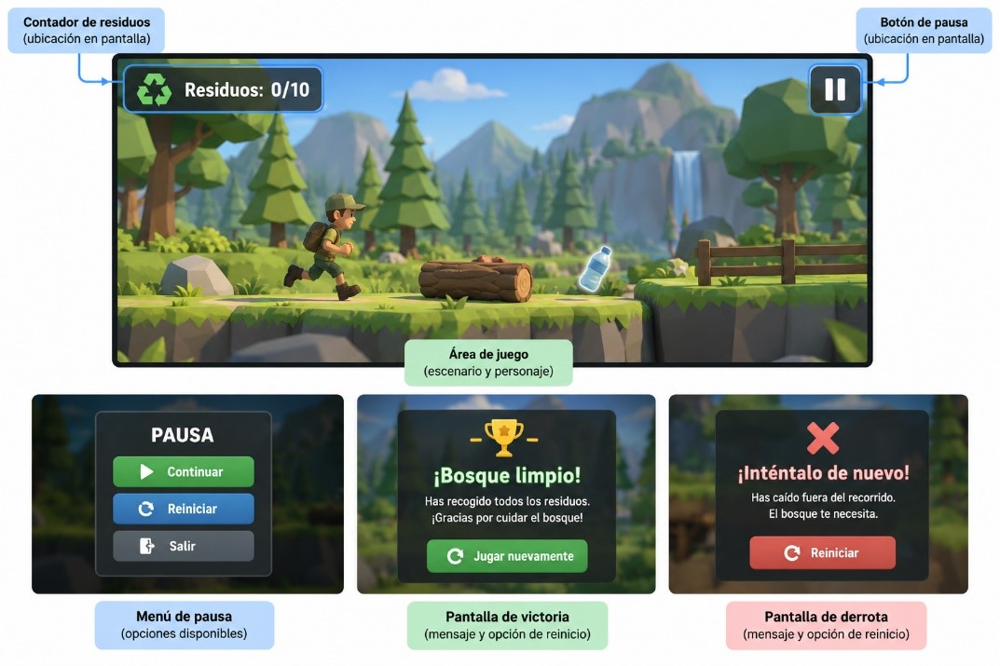

# 1. Información general y concepto
**Nombre:** Guardianes del Bosque

**Tipo de videojuego:** Minijuego educativo de plataformas y recorrido en **tercera persona** para PC, con posibilidad de adaptación posterior a dispositivos móviles.

**Género:** aventura educativa de recolección, exploración, plataformas y recorrido.

**Tema:** Cuidado de espacios naturales y manejo responsable de residuos.

**Público objetivo:** Estudiantes de 10 a 14 años.

**Estilo visual:** 3D low-poly, con un entorno de bosque natural y elementos visuales fácilmente identificables.

**Estilo sonoro:** ambiental y sencillo, utilizando sonidos del bosque y efectos asociados a las acciones principales del jugador.

**Concepto en una frase**

*En un bosque contaminado, el jugador* *controla un personaje encargado de* *asumir* *el papel de un guardián que explora diferentes zonas, supera obstáculos y* *clasifica y* *recoge residuos para recuperar progresivamente el entorno* *del ecosistema* *y avanzar hacia nuevas áreas del bosque.*

- *La idea no solo es recoger basura sino convertir el reciclaje en una* *mecánica* *de juego por ejemplo* *así:* 

- *Identificar -> recoger->clasificar->reciclar->recuperar todo el ecosistema*

# 2. Propósito social
 Promover la conciencia ambiental mediante una experiencia interactiva para enseñar de manera entretenida la importancia de separar correctamente los residuos y conservar os ecosistemas

- Este juego busca que el jugador comprenda que sus decisiones tienen consecuencias sobre el entorno.

- Ejemplo si el jugador coloca una botella de plástico en el contenedor correcto se le puede generar puntos los cuales llamaremos “de reciclaje”

- Pero si este jugador clasifica incorrectamente estos residuos tendría que perder puntos o se genera alguna consecuencia negativa al ecosistema

- Promover la conservación de los ecosistemas con letreros del juego 

*Guardianes del Bosque* busca sensibilizar a estudiantes de 10 a 14 años sobre el cuidado de los espacios naturales mediante la recolección responsable de residuos.

**Causa:** Cuidado de los espacios naturales y manejo responsable de los residuos.

**Aporte ciudadano esperado:** Que los estudiantes reconozcan la importancia de recoger los residuos que afectan los espacios naturales y comprendan la necesidad de mantenerlos limpios.

**Integración en la mecánica:** El propósito se incorpora directamente en la acción principal del jugador: recoger residuos. El jugador debe recolectar una cantidad determinada para limpiar el bosque.

**Pertinencia del videojuego:** La interacción permite que el estudiante experimente el propósito mediante sus propias acciones dentro del entorno, en lugar de recibir únicamente información teórica.

                                                 **Boceto de nivel**

**Objetivo del primer nivel**

El jugador tendrá que recoger y clasificar correctamente una cantidad determinada de residuos.

**Por ejemplo:**

**Objetivo: recoger 15 residuos.**

**Objetivo secundario:** terminar el nivel con menos de 3 errores de clasificación.

**Estructura**

Nivel	Ecosistema	Problema

1	🌳 Bosque	Basura general

2	🌊 Río	Contaminación del agua

3	🏖️ Playa	Plásticos

4	🏙️ Ciudad	Residuos urbanos

5	🌴 Selva	Deforestación + residuos

6	🌎 Ecosistema final	Restauración ambiental

Completar el nivel.

Completar el nivel con pocos errores.

Completar el nivel sin errores.

Progresión

# 3. Perfil de personas usuarias
## 3.1 Público objetivo
**Estudiantes de 10 a 14 años.**

Son estudiantes que pueden interactuar con videojuegos sencillos y comprender objetivos, reglas y desafíos progresivos. El diseño busca ofrecer una experiencia dinámica que combine exploración, plataformas y aprendizaje relacionado con el cuidado de los espacios naturales.
## 3.2 Contexto de uso
El videojuego está pensado como una experiencia de **entretenimiento y aprendizaje**, en la que el jugador pueda experimentar las consecuencias de sus acciones dentro de un entorno natural.

El jugador se encuentra ante un bosque afectado por la acumulación de residuos y debe explorar, tomar decisiones sobre su recorrido y superar obstáculos para recuperar progresivamente diferentes zonas del entorno.
## 3.3 Necesidades
Las personas usuarias necesitan:

- Controles sencillos y fáciles de comprender. 

- Objetivo visible y claro. 

- Desafíos que aumenten progresivamente. 

- Retroalimentación inmediata sobre sus acciones.

- Ver una consecuencia de sus acciones dentro del entorno. 

- Información importante disponible mediante más de un canal cuando corresponda. 

## 3.4 Preferencias
- Recorridos dinámicos. 

- Interacción directa con el entorno. 

- Retos sencillos de superar. 

- Respuesta inmediata a las acciones realizadas. 

- Recompensa visual por avanzar.

- Progresión clara entre las zonas del bosque.

Esto se relaciona directamente con nuestro diseño de correr, saltar y recoger.
## 3.5 Necesidad educativa
Fortalecer la relación entre la identificación de residuos, la toma de decisiones y la acción de cuidar un espacio natural.

El videojuego busca que el jugador no solamente observe que existe contaminación, sino que actúe sobre ella y pueda observar cómo sus acciones contribuyen a recuperar progresivamente el entorno.
## 3.6 Consideraciones de accesibilidad
El diseño utilizará controles sencillos, textos legibles, contraste adecuado y elementos visuales que permitan identificar las acciones y los objetos importantes. La información relevante no dependerá exclusivamente del sonido o del color.

# 4. Narrativa
## 4.1 Contexto
Un bosque que antes se encontraba en buenas condiciones ha comenzado a acumular residuos debido a la falta de cuidado de las personas que lo visitan. Botellas, latas, papeles, bolsas plásticas, vasos desechables y otros residuos se encuentran dispersos por diferentes zonas del bosque.
## 4.2 Rol del jugador
El jugador asume el papel del **Guardián del Bosque**, cuya tarea es recorrer el entorno y recoger los residuos para contribuir a recuperar la limpieza del espacio natural.
## 4.3 Desarrollo
Durante el recorrido, el jugador encuentra diferentes residuos y obstáculos que debe superar mediante el desplazamiento y los saltos. A medida que avanza por las tres zonas del nivel, debe recoger la cantidad necesaria de residuos para cumplir el objetivo.
## 4.4 Final
Cuando el jugador alcanza la cantidad objetivo de residuos y llega a la meta al final del recorrido, el bosque se considera limpio y se muestra el mensaje **“¡Bosque limpio!”**. Si el personaje cae fuera del recorrido (por ejemplo, a un arroyo), reaparece en el punto de control del inicio de la zona en la que cayó, conserva los residuos que ya recogió y el juego continúa; no hay que reiniciar el nivel.

# 5. Objetivo y reglas
## 5.1 Objetivo principal
El objetivo del jugador es recorrer el bosque, **recoger 10 residuos** y **llegar a la meta** al final del recorrido para completar la limpieza del espacio natural y finalizar exitosamente el nivel. Si llega a la meta con residuos pendientes, el juego le indica cuántos le faltan y puede volver a buscarlos.

La cantidad de residuos será un parámetro ajustable, por lo que posteriormente podremos cambiar 10 por otra cantidad sin modificar toda la lógica del juego.

## 5.2 Reglas principales

| Elemento | Regla | Respuesta del sistema | Parámetro |
| --- | --- | --- | --- |
| Recolección | El jugador entra en contacto con un residuo. | El residuo desaparece, el contador aumenta en 1 y se reproduce un sonido. | Cantidad objetivo |
| Obstáculos | El jugador debe saltar o desplazarse para superarlos. Los troncos que ruedan y las piedras que caen lo hacen trastabillar; el lodo lo frena. | Los obstáculos no hacen daño. Si cae a un arroyo (fuera del recorrido), vuelve al punto de control de la zona. | Ubicación de obstáculos |
| Progreso | El jugador continúa recorriendo las tres zonas y recogiendo residuos. | El HUD actualiza el contador, por ejemplo: **7/10**. | Cantidad de residuos |
| Victoria | El contador alcanza la cantidad objetivo y el jugador llega a la meta. | Se muestra **“ ¡Bosque limpio!”**. | Objetivo = 10 |
| Meta sin completar | El jugador llega a la meta con menos residuos que el objetivo. | Se muestra **“Te faltan N residuos”** y el juego continúa. | Objetivo = 10 |
| Caída | El personaje cae fuera del recorrido (a un arroyo, por debajo de la altura límite del nivel). | Reaparece en el punto de control del inicio de la zona actual, mirando hacia adelante, con los residuos ya recogidos. Se muestra unos segundos **“¡Te caíste! Vuelves al inicio de la zona con tus residuos.”** y suena el sonido de error. | Un punto de control por zona |
## 5.3 Condiciones de victoria y derrota
Victoria:

residuosRecogidos >= objetivo  Y  jugador llega a la meta        ¡Bosque limpio! 

Derrota:

No hay derrota en el nivel actual. Si el jugador cae fuera del recorrido (altura del personaje < límite del nivel, y = −2), reaparece en el punto de control de su zona y conserva los residuos. La pantalla **“¡Inténtalo de nuevo!”** queda lista para futuras reglas de derrota.

**5.4 Límites del juego**

Para mantener el proyecto dentro del alcance definido, el juego no tendrá:

- Vidas. 

- Barra de salud. 

- Temporizador. 

- Combate. 

- Enemigos. 

- Armas. 

- Clasificación de residuos. 

- Inventario. 

- Monedas. 

- Misiones secundarias.

# 6. Mecánicas y controles
## 6.1 Mecánicas principales
El juego es en **tercera persona**: la cámara (Cinemachine) sigue al personaje desde atrás y el jugador puede girarla con el ratón o el stick derecho; si no la mueve, vuelve sola detrás del personaje. El jugador se desplaza en cualquier dirección del suelo (adelante, atrás y a los lados) respecto a la cámara, y el personaje gira hacia donde camina. Debe responder de forma inmediata al desplazamiento y reproducir la animación correspondiente.
### 6.1.1. Explorar
El jugador recorre el bosque para localizar residuos y encontrar la ruta que le permita avanzar.

Respuesta del sistema:

El jugador se desplaza por el escenario y puede identificar diferentes rutas, obstáculos y residuos.
### 6.1.2. Superar obstáculos
El jugador debe utilizar el movimiento y el salto para acceder a diferentes partes del recorrido.

Los obstáculos son:

- Troncos y tocones. 

- Rocas. 

- Taludes de tierra (escalones del terreno de hasta 1,2 m que hay que subir saltando). 

- Arroyos que cruzan el sendero y hay que saltar (caer en uno devuelve al jugador al inicio de la zona). 

- Peligros dinámicos: cuatro troncos que ruedan (Zonas 2 y 3), piedra que cae y zona de lodo (ver 7.4 y 8.3).

- Barreras que cierran el paso: tronco atravesado, cerca de tres troncos que cubre todo el corredor e hileras de rocas o tocones (ver 8.3). Un modelo propio de cerca sigue previsto.

Algunos residuos estarán ubicados en posiciones que requieren superar estos obstáculos.
### 6.1.3. Recoger residuos
Cuando el jugador entra en contacto con un residuo:

*Contacto → residuo desaparece → contador aumenta → retroalimentación → contribuye a la limpieza de la zona.*

La recolección produce:

- aumento del contador; 

- efecto visual; 

- sonido de recolección; 

- actualización del progreso de la zona.

### 6.1.4. Recuperar la zona
**Estado:** implementado sin el desbloqueo de tramos. Las tres zonas siguen abiertas desde el inicio y para ganar sigue contando el total de residuos (ver 5.1), pero cada zona ya se recupera por separado:

- Al empezar el nivel, la vegetación de las tres zonas (árboles, arbustos, hierba y flores) se ve **contaminada**: un tono pardo y apagado.
- Cada residuo recogido hace brotar unas flores en ese punto (ver 10.4).
- Cuando una zona se recupera, además de volver al verde, **florece**: aparecen grupos de flores (margaritas, dientes de león, jacintos azules y rosas rojas) junto al camino, que crecen una tras otra en algo más de un segundo. Hay unas 80 a 90 flores por zona, en manchas de 4 a 7 de la misma especie, fuera del camino y sin estorbar residuos ni puntos de control. Al ganar florece todo el bosque.
- También **vuelven los animales**: en cada zona recuperada aparecen cuatro animales del paquete *Animals FREE* (ciervo, perro, gato, gallina y caballo, según la zona), que crecen igual que las flores. Unos pasean despacio de ida y vuelta por un tramo corto de unos 3 m y descansan un momento en cada extremo; los demás se quedan quietos con su animación de reposo. Son solo decoración: no tienen colisión, están dentro del bosque pero a más de 1,5 m del borde del camino (también en todo su paseo) y a 2 m o más de los residuos, los puntos de control y los obstáculos. Al ganar aparecen en todo el bosque.
- Cuando el jugador recoge **todos los residuos de una zona** (3 en la Zona 1, 4 en la Zona 2 y 5 en la Zona 3), la zona queda **recuperada** y su vegetación vuelve a verse **sana**, con sus colores normales. Las demás zonas no cambian.
- Al ganar (**“¡Bosque limpio!”**), todo el bosque se ve sano, aunque haya quedado algún residuo sin recoger.
- La barra **“Recuperación del bosque”** del HUD muestra el avance (ver 10.2).
- Al recuperarse una zona aparece unos 2 s en el HUD el aviso **“¡Zona recuperada!”**, en verde, con un sonido corto (dos notas ascendentes). Al ganar no aparece, porque ya lo dice la pantalla de victoria.

Por ahora el cambio es un cambio de material provisional (el mismo atlas de la vegetación teñido de pardo). Geordany puede reemplazarlo por su arte sin tocar código. El suelo no cambia, porque es una sola malla para todo el sendero. Quedan pendientes el desbloqueo del siguiente tramo y una animación del personaje al recuperar una zona.

| Zona contaminada | La misma zona, recuperada |
| --- | --- |
|  |  |

**Sonido de la zona:** mientras el jugador está en una zona contaminada suena el ambiente `bosque_contaminado_sound` (en bucle). Al recuperar esa zona, o al pasar a una zona ya recuperada, se hace un fundido de unos 3 s al ambiente de bosque recuperado (`sonido_bosque_recuperado`, en bucle); al entrar de nuevo en una zona contaminada, el fundido va al revés. En las zonas recuperadas se suman, más suaves, `Naturaleza-02` y los pájaros de `Avez`, que siguen el mismo fundido. Como la Zona 1 empieza contaminada, el nivel arranca con el ambiente contaminado.

Diseño original:

Cada zona tendrá una cantidad determinada de residuos.

Cuando el jugador recoge todos los residuos requeridos:

*Zona contaminada → zona recuperada → se habilita el siguiente tramo.*

Visualmente, la zona podrá presentar cambios sencillos, por ejemplo:

- desaparición de residuos visibles; 

- aparición de vegetación; 

- cambio de elementos contaminados a elementos naturales; 

- apertura del siguiente tramo del recorrido.

No necesitamos hacer una transformación gráfica extremadamente compleja. Incluso un cambio sencillo puede representar la recuperación.

## 6.2 ¿Qué pasa si el jugador no recoge un residuo?
No habrá clasificación incorrecta de residuos

Los ocho tipos:

- Botellas. 

- Latas. 

- Papeles. 

- Bolsas plásticas. 

- Cajas de jugo (Tetra Pak). 

- Vasos desechables. 

- Frascos de vidrio. 

- Pilas. 

tienen el mismo comportamiento.

Sin embargo, el jugador puede **equivocarse en su recorrido**:

- tomar una ruta innecesaria; 

- intentar superar un obstáculo incorrectamente; 

- caer fuera del recorrido; 

- tener que repetir la zona desde su punto de control. 

De esta manera existe desafío sin agregar un sistema complejo de clasificación.

**6.3 Core loop**

*Explorar → localizar residuos → decidir la ruta → superar obstáculos → recoger → recuperar la zona → desbloquear el siguiente tramo → continuar.*

**Control:**

- W / S → avanzar / retroceder. 

- A / D → moverse a la izquierda / derecha. 

- También se pueden utilizar las flechas ↑ ↓ ← → o el stick izquierdo del mando. 

- Ratón o stick derecho → girar la cámara. 

**Respuesta del sistema:**

- El personaje cambia de posición. 

- Se reproduce la animación **Run** mientras se desplaza. 

- Al dejar de moverse, vuelve a **Idle**. 

## 6.3.  Salto
El jugador puede saltar para superar obstáculos y alcanzar residuos ubicados en diferentes posiciones del recorrido.

**Control:**

- Espacio → saltar. 

**Respuesta del sistema:**

- El personaje se eleva. 

- Se reproduce la animación **Jump**. 

- Al regresar al suelo, continúa con **Idle** o **Run**, dependiendo del movimiento. 

- Una sombra circular oscura se dibuja en el suelo justo debajo del personaje y se achica con la altura, para que en 3D se pueda calcular dónde va a caer. 

- Ayudas: se puede saltar hasta 0,2 s después de salir de un borde y se recuerda la tecla de salto pulsada 0,15 s antes de tocar el suelo. 

## 6.4.  Recolección de residuos
Esta es la mecánica educativa principal del juego.

Cuando el personaje entra en contacto con un residuo, este se recoge automáticamente.

No habrá un botón adicional para recoger. Esto mantiene el control sencillo para el público de 10 a 14 años.
## 6.5.  Superación de obstáculos
El jugador debe utilizar el movimiento y el salto para superar troncos, rocas, taludes y arroyos ubicados en el recorrido. Ningún obstáculo sólido mide más de 1,2 m, para que siempre se pueda saltar.

Los obstáculos **no tienen una función de combate**. Su función es generar el desafío de recorrido.

Respuesta:

*Jugador encuentra obstáculo*  *Decide desplazarse o saltar*  *Supera el obstáculo*  *Continúa el recorrido*
## 6.6.  Pausa
La pausa se activa con la tecla **Esc** (o **Start** en el mando). No hay botón de pausa en pantalla, porque el cursor queda bloqueado mientras se juega.

Al activarla:

- Se detiene temporalmente el juego. 

- Se muestra el menú de pausa y se libera el cursor. 

- El sonido ambiente baja de volumen. 

- El jugador puede continuar, reiniciar o salir al menú principal (ver 10.3).

## 6.7.  Tabla general de controles

| Acción | Control | Respuesta del juego |
| --- | --- | --- |
| Moverse | W A S D / flechas / stick izquierdo | Personaje se desplaza en esa dirección respecto a la cámara |
| Mirar | Ratón / stick derecho | La cámara gira alrededor del personaje |
| Saltar | Espacio / botón inferior del mando | Personaje realiza un salto |
| Recoger residuo | Contacto | Residuo desaparece y aumenta el contador |
| Pausar | Esc / Start | Se detiene temporalmente el juego y se abre el menú de pausa |
# 7. Personaje y acciones
## 7.1.  Personaje principal
**Nombre:** Guardián del Bosque

**Rol:** Personaje controlado directamente por el jugador.

**Descripción:**

El Guardián del Bosque es un joven explorador encargado de recorrer las distintas zonas de un bosque contaminado, superar sus obstáculos y recoger los residuos dispersos en el entorno. Su función dentro del videojuego es representar una acción directa de cuidado y recuperación progresiva de los espacios naturales: cada zona que atraviesa queda más limpia gracias a su recorrido, lo que le permite avanzar hacia nuevas áreas del bosque.

**Características visuales:**

- Personaje humano. 

- Estilo visual **3D** **low-poly**. 

- Apariencia de explorador. 

- Elementos visuales sencillos y fácilmente identificables. 

- Utiliza el modelo de personaje definido para el proyecto.

## 7.2 Acciones del personaje
El personaje tendrá **tres acciones principales**:

| Acción | Descripción | Relación con el juego |
| --- | --- | --- |
| Correr / desplazarse | Permite explorar el bosque y recorrer sus distintas zonas. | Explorar el escenario, acercarse a los residuos y encontrar la ruta de avance. |
| Saltar | Permite superar obstáculos y alcanzar residuos ubicados en distintas posiciones. | Evitar troncos que ruedan, piedras que caen y cercas y alcanzar residuos elevados. |
| Recoger | Se activa por contacto con un residuo. | Contribuye a la recuperación de la zona y hace avanzar el indicador de contaminación. |
| Reaccionar al terreno | El personaje responde de forma distinta según el obstáculo que enfrenta | Ver tabla 7.4 |
## 7.3 Animaciones
Para el personaje se contemplan las siguientes animaciones:

- **Idle:** personaje quieto. 

- **Run:** personaje desplazándose. 

- **Jump:** personaje saltando. 

- Slow (en lodo): El personaje se desplaza con un paso más lento mientras esta sobre una zona de lodo.

- Stumble: Reacción breve al ser golpeado por un tronco que rueda o una piedra que cae, o al chocar de frente con un obstáculo (tronco, tocón o roca). Después del tropiezo el personaje sigue más lento durante 1,5 s (usa la misma animación Slow que el lodo).

- **Victory:** personaje al completar el objetivo de una zona del bosque.

Idle, Run (con Walk) y Jump vienen del paquete Starter Assets de Unity. Slow, Stumble y Victory ya existen en el Animator, pero por ahora usan clips provisionales.

## 7.4 Comportamiento
El personaje responde a las acciones del jugador y a los distintos elementos del entorno:

| Situación | Comportamiento del personaje |
| :--- | :--- |
| Comando de movimiento | Se desplaza y reproduce la animación de Run. |
| Comando de salto | Se eleva, reproduce Jump y aterrizar vuelve a Idle o Run según corresponda. |
| Contacto con un residuo | Lo recoge automáticamente, se actualiza el contador y el indicador de contaminación de la zona del bosque. |
| Contacto con tronco que rueda o piedra que cae, o choque de frente con un obstáculo | Tropieza: pierde el control medio segundo, retrocede un poco y reproduce Stumble. Al recuperar el control avanza a la mitad de velocidad durante 1,5 s y luego vuelve a la normal. Durante 1 s después del tropiezo no vuelve a tropezar. Pararse encima de un obstáculo o rozarlo de lado no cuenta como choque. Si cae fuera del recorrido, se activa la condición de derrota |
| Entrar en una zona de lodo | Reduce su velocidad de desplazamiento y reproduce la animación Slow mientras permanece en esa zona, recupera velocidad al salir |
| Recuperar una zona completa | Reproduce una animación breve de satisfacción o alivio (puede compartirse con Victory a escala reducida), coherente con el avance del indicador de contaminación |
## 7.5 Limitaciones del personaje
Para mantener el diseño sencillo, el Guardián del Bosque:

- No utiliza armas. 

- No combate. 

- No tiene ataques. 

- No tiene enemigos. 

- No posee inventario. 

- No clasifica los residuos. 

- No tiene sistema de salud. 

- No tiene vidas. 

Su función principal es **explorar, saltar, recoger y adaptarse a las condiciones del terreno de** **cada** **zona.**

# 8. Entorno y diseño del nivel
## 8.1 Entorno
El videojuego se desarrolla en un **bosque natural en estado de contaminación**, representado mediante un estilo visual 3D low-poly. El escenario combina elementos naturales con residuos y obstáculos que forman parte del recorrido del jugador.

**Elementos naturales**

- Árboles. 

- Vegetación. 

- Rocas. 

- Suelo. 

- Montañas. 

- Arroyos, que suenan a agua corriendo al acercarse. 

- Flores y animales (ciervo, perro, gato, gallina y caballo) que aparecen al recuperar cada zona (ver 6.1.4). 

- Otros elementos propios de un entorno boscoso. 

**Elementos interactivos**

- Residuos. 

- Obstáculos. 

- Recorrido/plataformas. 

Los elementos estarán distribuidos de manera que sean **visualmente identificables** para el jugador.
## 8.2 Estructura del nivel
El juego tendrá **un solo nivel**, dividido en **tres zonas** con dificultad progresiva.

El nivel es un **sendero de bosque con curvas de unos 281 m**: un camino de tierra de 4 m dentro de un corredor caminable de 12 m (más ancho en los claros), con taludes de tierra de hasta 1,2 m y arroyos que lo cruzan. Las zonas se reparten por distancia a lo largo del sendero: Zona 1 de 0 a 94 m, Zona 2 de 94 a 188 m y Zona 3 de 188 a 281 m. Paredes invisibles impiden salir del corredor; la meta está al final del sendero.

**Zona 1 — Aprendizaje**

Propósito: Area limpia donde el jugador conozca y aprenda de los controles y las mecánicas.

**Características**:

- Pocos obstáculos. 

- Residuos fácilmente visibles. 

- Espacios amplios. 

- Saltos sencillos (sin arroyos; un talud de 0,8 m). 

- Primer contacto con la mecánica de recolección. 

**Diseño:** el jugador aprende principalmente a **moverse, saltar y recoger**.

**Zona 2 — Desarrollo**

Propósito: aumentar progresivamente el desafío.

Características y elementos: Aprecen botllas, latas, papeles y otros residuos

- Mayor cantidad de obstáculos

- Mayor cantidad de residuos en todo el nivel.

- Combinación de desplazamientos y saltos. 

- Menor espacio entre algunos elementos. 

- Primer arroyo, zona de lodo y dos troncos que ruedan. 

Aquí el jugador debe empezar a tomar decisiones sobre cuándo desplazarse y cuándo saltar.

**Zona 3 — Desafío**

Propósito: representar la parte de mayor dificultad del recorrido.

Características:

- Mayor concentración de obstáculos. 

- Residuos ubicados en posiciones que requieren saltos. 

- Recorrido más exigente. 

- Combinación de diferentes obstáculos: dos arroyos, el talud más alto (1,2 m), dos troncos que ruedan y la piedra que cae. 

Al superar esta zona y alcanzar la cantidad necesaria de residuos, el jugador puede completar el objetivo.

## 8.3 Obstáculos
Los obstáculos principales son:

- **Troncos y tocones** 

- **Rocas** 

- **Taludes y arroyos** del propio terreno 

- **Peligros dinámicos:** troncos que ruedan (Zonas 2 y 3), zona de lodo (Zona 2) y piedra que cae, anunciada antes por una sombra en el suelo (Zona 3). Hay cuatro troncos rodantes, cada uno en su propio tramo libre del camino y ninguno en la Zona 1, que enseña lo básico. En la Zona 2, uno cruza el camino de lado a lado en el claro antes del lodo (s ≈ 115) y otro rueda a lo largo del camino entre la roca de s 147 y la hilera de tocones (s ≈ 158, con una botella colgando encima). En la Zona 3, uno rueda a lo largo de la cima del último talud (s ≈ 222) y otro cruza el camino entre la roca de s 240 y el tronco tendido de s 250 (s ≈ 244,5). Nada sólido, ningún residuo, punto de control ni otro peligro queda en su recorrido. 

Además de los obstáculos sueltos, hay **barreras que cierran el paso**: un tronco atravesado en el camino, una cerca de tres troncos que cubre todo el corredor (solo se pasa saltando) e hileras de rocas o tocones con huecos más estrechos que el jugador. Todos miden 1,2 m o menos. Hay 13 obstáculos sólidos en la Zona 1, 14 en la Zona 2 y 16 en la Zona 3 (incluidas seis rocas que colocó Jhon).

Su función no es causar daño mediante un sistema de salud, sino interrumpir el recorrido y exigir al jugador utilizar el salto o el desplazamiento. Chocar de frente con uno hace tropezar al jugador y lo deja más lento durante 1,5 s (ver 7.4), igual que los peligros dinámicos.

Los obstáculos no hacen caer al jugador por sí solos. Caer a un arroyo no hace perder: el jugador vuelve al punto de control de la zona.
## 8.4 Distribución de residuos
Se utilizarán ocho tipos de residuos y se clasificaran de la siguiente manera:

- Botellas. 

- Latas. 

- Papeles. 

- Bolsas plásticas. 

- Cajas de jugo (Tetra Pak). 

- Vasos desechables. 

- Frascos de vidrio. 

- Pilas. 

Todos tienen **el mismo comportamiento programado**:

Contacto → desaparece → contador +1 → sonido de recolección.

No existe clasificación entre residuos.

Esto es importante porque mantiene el propósito educativo en la acción de **recoger y limpiar** el espacio natural, sin agregar una mecánica de reciclaje/clasificación que aumentaría el alcance del proyecto.

**Ubicación actual:** hay **12 residuos** en el nivel (2 más que el objetivo de 10): 3 en la Zona 1, 4 en la Zona 2 y 5 en la Zona 3. **Todos exigen saltar**: cuelgan sobre el camino a 1,9–2,5 m (fuera del alcance a pie, dentro del salto), encima de un arroyo, en lo alto de un claro o sobre una roca. El primero, en la Zona 1, enseña a saltar para recoger; otro se toma al saltar la cerca de troncos.
## 8.5 Recorrido del jugador
El recorrido general será:

*INICIO*  *ZONA 1 Aprendizaje*  *ZONA 2 Desarrollo*  *ZONA 3 Desafío*  *OBJETIVO*  *¡BOSQUE LIMPIO!*

Dentro de cada zona se distribuirán obstáculos y residuos para que el jugador tenga que desplazarse y saltar mientras avanza.

**8.6 Diseño visual del nivel**

El nivel tendrá una estética **3D** **low-poly**, utilizando formas y elementos visuales sencillos.

Se buscará que exista una diferencia visual clara entre:

**Naturaleza**

- Árboles 

- Vegetación 

- Suelo 

- Rocas 

**Residuos**

- Botellas 

- Latas 

- Papeles 

- Bolsas plásticas 

- Cajas de jugo 

- Vasos desechables 

- Frascos de vidrio 

- Pilas 

Los residuos usan colores claros y saturados que no aparecen en la naturaleza del nivel (blanco, cian claro, amarillo y plateado) y evitan el rojo, el naranja, el rosado, el azul y el verde, porque las flores, los hongos y la vegetación ya los usan. Además brillan un poco, flotan y giran, para que se distingan sin depender solo del color.

**Obstáculos**

- Troncos 

- Rocas 

- Cercas de troncos (un modelo propio de cerca sigue previsto) 

Los obstáculos y peligros usan un material oscuro, para que se distingan de los residuos claros y brillantes.

Esto facilita que los estudiantes de 10 a 14 años puedan identificar rápidamente qué elementos deben **recoger** y cuáles deben **superar**.

# 9. Recursos visuales y audiovisuales
Esta sección define **qué recursos necesitamos para construir el videojuego** y en qué formato estarán.
## 9.1 Recursos visuales

| Recurso | Uso | Formato |
| --- | --- | --- |
| Personaje Guardián del Bosque | Personaje principal controlado por el jugador | FBX / Prefab |
| Árboles y vegetación | Construcción del bosque | FBX / Prefab |
| Rocas y montañas | Ambientación y obstáculos | FBX / Prefab |
| Troncos (obstáculo estático) | Obstáculos del recorrido | FBX / Prefab |
| Tronco rodante | Obstáculo dinámico que se desplaza por el recorrido | FBX / Prefab + animación de rotación |
| Piedra que cae | Obstáculo dinámico que se desplaza por el recorrido | FBX / Prefab + animación de caída |
| Zona de lodo | Terreno que reduce la velocidad del personaje | FBX / Prefab + shader o material distinto |
| Cercas | Obstáculos del recorrido | FBX / Prefab |
| Botellas | Residuos recolectables | FBX / Prefab |
| Latas | Residuos recolectables | FBX / Prefab |
| Papeles | Residuos recolectables | FBX / Prefab |
| Bolsas plásticas | Residuos recolectables | FBX / Prefab |
| Cajas de jugo | Residuos recolectables | FBX / Prefab |
| Vasos desechables | Residuos recolectables | FBX / Prefab |
| Frascos de vidrio | Residuos recolectables | FBX / Prefab |
| Pilas | Residuos recolectables | FBX / Prefab |
| Elemento de recuperación de zona (vegetación nueva, agua limpia) | Representar visualmente que una zona pasó de contaminada a recuperada (hoy: cambio de material, flores y animales) | FBX / Prefab + material |
| Flores de recuperación | Brotan al recoger cada residuo y al recuperar una zona | FBX / Prefab |
| Animales del bosque | Aparecen al recuperar una zona, paseando o en reposo | FBX / Prefab + animaciones |
| Icono de residuos | Identificación del contador | PNG / SVG |
| Indicador de contaminación | Mostrar el avance de la limpieza (barra o medidor) | PNG / SVG |
| Icono de pausa | Botón de pausa | PNG / SVG |
| Elementos de interfaz | Mensajes de victoria y derrota | PNG / SVG |
## 9.2 Recursos sonoros
Los recursos sonoros se clasificarán en cuatro categorías principales:

1. Música de fondo:

Bucle dinámico / adaptativo: Un tema ambiental relajante y orgánico para el bosque.

Capas dinámicas: A medida que el jugador limpia más residuos en la zona, se añaden 	capas instrumentales progresivas (por ejemplo, entrada de cuerdas o vientos ligeros) para 	dar una sensación de progresión visual y sonora.

2. Ambiente:

Sonido ambiental del bosque: Viento suave, follaje, cantos de pájaros, río o agua 	corriendo.

Sonido de zona contaminada vs. zona limpia: En zonas con residuos, el ambiente puede 	incluir zumbidos de moscas o vientos secos; al limpiar la zona, el ambiente cambia a 	sonidos de naturaleza viva.

3. Efectos de sonido de acciones del jugador:

Movimiento y Plataformas: Pasos sobre césped/tierra, salto, aterrizaje.

Recolección y Limpieza:

Sonido de recolección de basura.

Sonido de depósito o clasificación correcta de residuos en contenedores.

Sonido de retroalimentación positiva al recuperar una sección del bosque (un jingle breve 	o stinger).

4. Interfaz de usuario

Clics en botones, pausa, sonidos de confirmación y error al interactuar con el menú o 	mapas educativos.

| **Categoría** | **Nombre** | **Función** | **Formato** |
| --- | --- | :---: | :---: |
| Música de fondo | BGM_Bosque_Base | Tema ambiental relajante y orgánico base del bosque. | .ogg / .mp3 |
| Música de fondo | BGM_Bosque_Capa_Cuerdas | Capa musical de cuerdas que se activa dinámicamente al avanzar en la limpieza. | .ogg / .mp3 |
| Música de fondo | BGM_Bosque_Capa_Vientos | Capa musical de instrumentos de viento para transmitir progreso total de la zona. | .ogg / .mp3 |
| Ambiente | AMB_Bosque_Limpio | Sonido ambiental de naturaleza viva (viento suave, follaje, río, cantos de pájaros). | .ogg / .mp3 |
| Ambiente | AMB_Zona_Contaminada | Sonido ambiental de zona sucia o contaminada (zumbido de moscas, viento seco). | .ogg / .mp3 |
| Acciones del jugador | SFX_Pasos_Cesped | Retroalimentación auditiva del movimiento del personaje sobre césped/tierra. | .wav |
| Acciones del jugador | SFX_Salto | Sonido al ejecutar un salto en plataformas. | .wav |
| Acciones del jugador | SFX_Aterrizaje | Sonido al hacer contacto con el suelo tras un salto o caída. | .wav |
| Acciones del jugador | SFX_Recoger_Basura | Feedback sonoro inmediato al recoger un residuo del suelo. | .wav |
| Acciones del jugador | SFX_Clasificacion_Correcta | Confirmación auditiva al depositar un residuo en el contenedor adecuado. | .wav |
| Acciones del jugador | SFX_Recuperacion_Zona | Jingle breve (stinger) de retroalimentación positiva al limpiar una sección completa. | .wav |
| Interfaz de usuario | UI_Boton_Click | Sonido sutil al presionar un botón del menú o la interfaz. | .wav |
| Interfaz de usuario | UI_Pausa | Indicador sonoro al abrir o cerrar el menú de pausa. | .wav |
| Interfaz de usuario | UI_Confirmacion | Retroalimentación al seleccionar opciones o interactuar con el mapa educativo. | .wav |
| Interfaz de usuario | UI_Error | Alerta auditiva cuando se realiza una acción inválida o error de clasificación. | .wav |
**Estado actual del audio:** el ambiente sigue la recuperación del bosque: `bosque_contaminado_sound` en las zonas contaminadas y `sonido_bosque_recuperado` en las recuperadas, con un fundido entre ambos (los dos en `Assets/Sound/Ambient/`; las pistas anteriores `ambient_sound_one` y `ambient_sound_two` ya no se usan), el sonido de recolección de residuos (`Assets/Sound/SFX/collectible_pickup_sound.wav`, con una ligera variación de tono) los pasos y el aterrizaje del paquete Starter Assets y el sonido de salto: en cada salto suena, al azar, uno de los tres sonidos que aportó Jhon (`JumpAudio1`, `jumpAudio2` y `JumpAudio3`, en `Assets/Sound/SFX/`), en 2D (ver 6.1.4 para el fundido por zona). Al recuperar una zona suena un sonido corto con el aviso “¡Zona recuperada!”, y al brotar flores tras recoger un residuo suena `flowers_sound`. En las zonas recuperadas, sobre `sonido_bosque_recuperado`, se suman suavemente `Naturaleza-02` y los pájaros de `Avez`, que se apagan con el mismo fundido en una zona contaminada. Cada arroyo suena a agua corriendo (`river`), y se oye al acercarse al cruce. Cada uno de los cuatro troncos rodantes suena mientras rueda (`GolpesTronco`) y da un golpe seco (`impactWood02`) cada vez que llega a un extremo y se da la vuelta; con la pausa se detiene. Al pausar, el ambiente baja de volumen. El ambiente y los efectos del jugador son 2D; el río y los troncos son 3D. Faltan la música y los sonidos de interfaz.

## 9.3 Recursos de interfaz
La interfaz será sencilla y contendrá únicamente la información necesaria para que el jugador conozca su progreso.

Elementos:

- Contador de residuos. 

- Indicador de contaminación: la barra “Recuperación del bosque”, bajo el contador (ver 10.2)

- Icono de residuos. 

- Botón de pausa (por ahora la pausa es con Esc, ver 6.6). 

- Mensaje de victoria. 

- Mensaje de derrota. 

- Botón para reiniciar.

## 9.4 Origen y licencia
Los recursos visuales y sonoros utilizados serán seleccionados de fuentes compatibles con el proyecto (Unity Asset Store, Kenney, OpenGameArt, Mixamo, Freesound, Google Fonts, entre otras). Para cada recurso externo se verificará su origen y licencia de uso, registrando la información correspondiente antes de la entrega.

# 10. HUD e interfaz
## 10.1 Objetivo del HUD
El HUD permitirá al jugador conocer en todo momento su progreso y acceder a las funciones básicas del juego sin interrumpir el recorrido.

La información principal será el **número de residuos recogidos**.

## 10.2 Elementos del HUD durante la partida
**Contador de residuos**

Se ubica en la esquina superior izquierda de la pantalla:

♻️ **Residuos: 0/10**

A medida que el jugador recoja residuos:

♻️ **Residuos: 1/10** ♻️ **Residuos: 2/10** ♻️ **Residuos: 3/10**

Y así sucesivamente hasta:

♻️ **Residuos: 10/10**

Esto permite que el jugador sepa claramente **cuánto ha avanzado y cuánto le falta**.

**Barra “Recuperación del bosque”**

Bajo el contador hay una barra que muestra cuánto se ha recuperado el bosque: es el promedio del avance de las tres zonas (residuos recogidos en cada zona sobre los que tiene). Sube con cada residuo, cada zona recuperada suma un tercio, y se llena del todo cuando las tres zonas están recuperadas o al ganar. Como el nivel tiene 12 residuos y el objetivo son 10, se puede ganar sin haber llenado la barra; al ganar se completa.

**Aviso “¡Zona recuperada!”**

Cuando el jugador recoge el último residuo de una zona aparece “¡Zona recuperada!” en verde sobre un panel oscuro, unos 2 s, y se desvanece al final, acompañado de un sonido corto (`sonido_zona_recuperada.wav`, provisional). Está en el centro, entre la flecha hacia la meta y el banner del objetivo, a la derecha del contador, así que no tapa ninguno de ellos ni los demás avisos.

**Indicador de dirección hacia la meta**

Una flecha pequeña y discreta en el centro de la parte superior de la pantalla señala, desde el punto de vista de la cámara, hacia dónde queda la meta siguiendo el sendero: apunta a un punto unos 10 m más adelante en el camino, así que en las curvas sigue el sendero en lugar de señalar a través de los árboles, y al final apunta a la meta misma. Gira suavemente, sin saltos.

Si el jugador corre de vuelta hacia el inicio durante más de 1 s, la flecha se vuelve naranja y aparece a su lado **“Vas en sentido contrario”**. El aviso desaparece en cuanto vuelve a avanzar hacia la meta. Cruzar el camino o rodear un obstáculo no lo activa, y nada parpadea (accesibilidad). La flecha se oculta en la pausa y en las pantallas de victoria y derrota.

**Pausa**

Por ahora no hay botón en pantalla: la tecla Esc (o Start en el mando) abre el menú de pausa. Un botón ⏸️ queda pendiente para cuando se use mando o pantalla táctil.

## 10.3 Menú de pausa
El menú tendrá únicamente las opciones necesarias:

**PAUSA**

- ▶️ Continuar 

- 🔄 Reiniciar 

- 🚪 Salir 

Debajo se lee “Pulsa Esc para seguir jugando.”. **Continuar** queda seleccionado (Enter o Espacio sirven sin ratón), **Reiniciar** vuelve a cargar el nivel y **Salir** lleva al menú principal (ver 10.8).

No incluiremos configuraciones complejas ni otros menús porque no son necesarios para el alcance del proyecto.

## 10.4 Retroalimentación de recolección
Cuando el jugador recoja un residuo:

*Jugador toca residuo*  *Residuo desaparece*  *♻️* *+1*  *Sonido de recolección*  *Brotan flores*

**Flores donde estaba el residuo:** al recogerlo brotan unas 5 flores del *Low Poly Flower Pack* (margaritas, dientes de león, jacintos azules y rosas rojas) en el suelo bajo ese punto, una tras otra con una animación corta de crecimiento (medio segundo cada una, con un pequeño rebote), acompañadas del sonido `flowers_sound` (una vez por residuo). No tienen colisión y nunca quedan sobre el camino: si el residuo estaba encima del camino brotan a ambos lados, y si estaba sobre un arroyo, en la orilla más cercana. Así el recorrido va quedando marcado por las flores de lo que se ha limpiado.
## 10.5 Pantalla de victoria
Cuando:

residuosRecogidos >= objetivo y el jugador llega a la meta

se mostrará:

 **¡Bosque limpio!**

con el detalle “Recogiste N residuos.” y una opción:

 **Jugar de nuevo**

La pantalla de victoria indicará claramente que el objetivo fue completado.

**Aviso de residuos pendientes:** si el jugador llega a la meta sin el objetivo, aparece unos segundos “Te faltan N residuos. ¡Vuelve a buscarlos!” y el juego continúa.
## 10.6 Pantalla de derrota
Caer fuera del recorrido ya no la muestra: el jugador reaparece en el punto de control de la zona con un aviso breve (ver 5.2). La pantalla queda preparada para una regla de derrota futura:

 **¡Inténtalo de nuevo!**

con el detalle “Te caíste del recorrido.” y una opción:

 **Reintentar**

No habrá una pantalla de "Game Over" compleja porque el juego no utiliza vidas ni sistema de salud.
## 10.7 Estructura general de la interfaz
Podemos visualizarla así:

La interfaz debe permanecer simple y legible, evitando llenar la pantalla con información que no sea necesaria.

## 10.8 Menú principal
El juego empieza en el menú principal (escena `MainMenu`), con la misma paleta que las pantallas del juego:

- Título: **Guardianes del Bosque**. 

- Objetivo en una línea: “Recorre el sendero, recoge 10 residuos y llega a la meta para limpiar el bosque.” 

- Botones **Jugar** (seleccionado al abrir, carga el nivel) y **Salir** (cierra el juego). 

- Controles: “WASD o flechas: moverte · Ratón: mirar · Espacio: saltar · Esc: pausa”.

# 11. Accesibilidad: WCAG 2.2 y DUA
El diseño inclusivo de Guardianes del Bosque se alinea con las pautas de accesibilidad WCAG 2.2 (niveles A y AA) y los principios del Diseño Universal para el Aprendizaje (DUA), asegurando que la experiencia sea accesible para estudiantes con diversas capacidades visuales, auditivas, motoras y cognitivas.
## 11.1.	Principios Generales de Accesibilidad (WCAG 2.2)
Perceptible: La información y los elementos de la interfaz son presentados a los usuarios en formas que ellos puedan percibir (múltiples canales sensoriales).   

Operable: La interfaz y la navegación son operables mediante diversos esquemas de control y tolerancia al fallo.   

Comprensible: La información y el manejo de la interfaz son claros, predecibles y directos.   Robusto: El juego funciona de manera consistente en diferentes dispositivos y resoluciones de pantalla.  
## 11.2. 	Aplicación de los Principios DUA (Diseño Universal para el Aprendizaje)
Múltiples formas de Representación: Presentación de los elementos interactivos, objetivos y progresos mediante una combinación de texto, iconos, contraste de color y efectos audiovisuales redundantes.   

Múltiples formas de Acción y Expresión: Opciones para interactuar mediante controles reasignables, asistentes de movimiento y tolerancia temporal en las plataformas.   

Múltiples formas de Compromiso: Un objetivo claro, retroalimentación inmediata, curva de dificultad progresiva y entornos sin penalizaciones severas para favorecer la motivación continua.
## 11.3.	Retroalimentación Multisensorial y No Dependencia Exclusiva del Color (WCAG 1.4.1 y 1.4.3)
Para garantizar que los estados del juego y los interactivos sean perceptibles independientemente de deficiencias visuales o auditivas (o entornos de aula con audio desactivado):

Doble Canalización Sostenida: Ninguna acción depende únicamente de sonido o color.

Modos de Paleta de Color y Contraste:

Soporte para filtros de color desde el menú de opciones (Protanopía, Deuteranopía, Tritanopía).

Relación de contraste mínima de 4.5:1 en todos los textos de la interfaz respecto al fondo.
## 11.4.	Asistencia de Control y Adaptabilidad Motora (WCAG 2.1 y 2.4)
Para facilitar la jugabilidad a estudiantes con dificultades en la motricidad fina o en la velocidad de respuesta:

Controles Simples por Defecto: 

Moverse: Teclas W A S D o flechas, o el stick izquierdo del mando. Mirar: ratón o stick derecho.   

Saltar: Tecla Espacio.   

Reasignación de Teclas: Posibilidad de reconfigurar los controles desde el menú de opciones (pendiente).   Asistente de Plataformeo : Ventana de tolerancia temporal que permite ejecutar el salto hasta 0.2 segundos después de haber dejado el borde de una plataforma, y memoria del salto de 0.15 segundos si se pulsa justo antes de tocar el suelo (implementados). Una sombra bajo el personaje ayuda a calcular dónde va a caer.

Zona de Recolección Ampliada: La colisión para recoger residuos posee un radio de captura amplio (0,7 m), evitando la exigencia de máxima precisión sobre el objeto.

Los menús se pueden usar sin ratón: el botón principal de cada pantalla queda seleccionado y se confirma con Enter, Espacio o el mando. El desenfoque de movimiento, el grano de película, la aberración cromática y la distorsión de lente están desactivados.
## 11.5.	Accesibilidad Cognitiva y Comprensión del Objetivo (WCAG 3.2 y 3.3)
HUD Claro e Ininterrumpido: Muestra permanente del progreso mediante el formato Residuos: X/10 para evitar sobrecargar la memoria de trabajo del estudiante.   

Guía de Navegación Contextual: Indicador visual sutil para orientar al jugador. Ya existe una flecha discreta en el HUD que señala el camino hacia la meta y avisa “Vas en sentido contrario” si el jugador retrocede (ver 10.2). Queda pendiente, como opción, una guía hacia el siguiente residuo (línea de huellas).

Formato de Texto Legible y Accesible:

Uso de tipografías Sans-Serif de alta legibilidad (ej. Atkinson Hyperlegible o Arial).

Instrucciones breves con opción de Lectura en Voz Alta (Text-to-Speech) para 	estudiantes con dislexia o en proceso de afianzamiento lectoescritor.   

Enfoque Sin Distractores: Ausencia de mecánicas secundarias complejas (sin inventarios, estadísticas de salud o temporizadores de cuenta regresiva) que generen ansiedad o desvíen del objetivo de aprendizaje.

# 12. Alcance y limitaciones
## 12.1 Alcance del proyecto
*Guardianes del Bosque* será un videojuego educativo de plataformas y recorrido compuesto por:

- **1 personaje jugable:** Guardián del Bosque. 

- **1 nivel:** dividido en 3 zonas. 

- **3 acciones principales:** correr, saltar y recoger. 

- **8 tipos de residuos:** botellas, latas, papeles, bolsas plásticas, cajas de jugo, vasos desechables, frascos de vidrio y pilas. 

- **Obstáculos:** troncos, rocas, taludes, arroyos y barreras que cierran el paso (cercas de troncos e hileras de rocas o tocones), más tres tipos de peligros dinámicos (cuatro troncos que ruedan, piedra que cae y zona de lodo). 

- **1 objetivo principal:** recoger 10 residuos (hay 12 en el nivel) y llegar a la meta. 

- **1 sistema de progreso:** contador de residuos y barra “Recuperación del bosque”; cada zona se recupera por separado (vegetación sana, flores y animales). 

- **1 condición de victoria:** alcanzar la cantidad objetivo y llegar a la meta. 

- **Sin derrota:** caer fuera del recorrido (a un arroyo) devuelve al jugador al punto de control de la zona, con sus residuos. 

- **HUD básico:** contador y barra de recuperación; aviso “¡Zona recuperada!”; flecha hacia la meta con aviso de sentido contrario; pausa con Esc. 

- **Menú principal y menú de pausa.** 

- **Cámara en tercera persona** que sigue al personaje. 

- **Sistema de audio básico:** ambiente que cambia entre zona contaminada y recuperada, río en los arroyos, troncos rodantes y efectos de las acciones principales. 

- **Estilo visual:** 3D low-poly. 

## 12.2 Elementos que quedan fuera del alcance
Para mantener el proyecto manejable, no se implementarán:

- Enemigos. 

- Combate. 

- Armas. 

- Sistema de vidas. 

- Barra de salud. 

- Temporizador. 

- Monedas. 

- Inventario. 

- Clasificación de residuos. 

- Sistema de reciclaje. 

- Misiones secundarias. 

- Diferentes niveles independientes. 

- Jefes o enemigos finales. 

- Árbol de habilidades. 

- Sistema de experiencia. 

- Tienda. 

- Diálogos complejos. 

- Cinemáticas. 

## 12.3 Limitaciones técnicas
El proyecto estará limitado a las funcionalidades necesarias para cumplir el objetivo educativo y las mecánicas principales. La complejidad de los sistemas será reducida para facilitar su implementación, prueba y corrección durante el desarrollo.

Además:

- La cantidad de residuos será un parámetro configurable. 

- La distribución de obstáculos podrá modificarse sin cambiar las mecánicas principales. 

- Los recursos externos deberán ser revisados para verificar su origen y licencia. 

- Las funciones adicionales podrán quedar fuera del proyecto si afectan el alcance establecido. 

# 13. Referencias, origen y licencias
## 13.1 Inventario de recursos
Para *Guardianes del Bosque* se llevará un registro de los recursos externos utilizados durante el desarrollo.

| Recurso | Uso | Formato | Origen | Licencia |
| --- | --- | --- | --- | --- |
| Personaje ("Timmy") | Personaje principal | FBX / Prefab | Mixamo (Adobe), personaje "Timmy": https://www.mixamo.com/#/?page=2&type=Character | Términos de uso de Mixamo (por verificar y archivar la fecha de descarga) |
| Controlador, animaciones y sonidos de pasos del personaje | Movimiento, animaciones Idle/Walk/Run/Jump y SFX de pasos/aterrizaje | C# / FBX / WAV | Unity Asset Store: "First Person + Third Person \| Character Controllers" (Unity Starter Assets), en `Assets/Starter Assets`: https://assetstore.unity.com/packages/3d/characters/first-person-third-person-character-controllers-196526 | Unity Companion License (según la página del asset: los recursos pueden reutilizarse en proyectos propios; revisar la licencia completa para los términos de uso y redistribución) |
| Árboles y vegetación | Entorno | FBX / Prefab | Unity Asset Store: "Low-Poly Simple Nature Pack" (JustCreate), v1.24, en `Assets/SimpleNaturePack`: https://assetstore.unity.com/packages/3d/environments/landscapes/low-poly-simple-nature-pack-162153 | Standard Unity Asset Store EULA (Extension Asset) |
| Rocas (y suelo) | Entorno | FBX / Prefab | Unity Asset Store: "Low-Poly Simple Nature Pack" (JustCreate), v1.24, en `Assets/SimpleNaturePack`: https://assetstore.unity.com/packages/3d/environments/landscapes/low-poly-simple-nature-pack-162153 | Standard Unity Asset Store EULA (Extension Asset) |
| Montañas | Entorno | FBX / Prefab | Colinas del paquete "Low-Poly Simple Nature Pack" (JustCreate), pieza `Ground_02` escalada; ver enlace en la fila de árboles | Standard Unity Asset Store EULA (Extension Asset) |
| Troncos | Obstáculos | FBX / Prefab | Tocón, tronco y rama del paquete "Low-Poly Simple Nature Pack" (JustCreate), ver enlace en la fila de árboles; el tronco que rueda usa la rama `Branch_01` del mismo paquete | Standard Unity Asset Store EULA (Extension Asset) (solo las piezas del paquete) |
| Cercas | Obstáculos | FBX / Prefab | Cerca de tres troncos armada con el tronco del paquete "Low-Poly Simple Nature Pack" (ver fila de troncos); un modelo propio de cerca sigue previsto | Standard Unity Asset Store EULA (Extension Asset) |
| Animales de recuperación | Entorno (animales que aparecen al recuperar una zona) | FBX / Prefab / Animación | Unity Asset Store: "Animals FREE - Animated Low Poly 3D Models" (ithappy), en `Assets/ithappy/Animals_FREE` (ciervo, perro, gato, gallina y caballo con sus animaciones de reposo y paseo, usados a través de las variantes de `Assets/Prefabs/Environment/RecoveryAnimals`; los archivos del paquete no se modifican). Enlace por verificar | Standard Unity Asset Store EULA (por verificar) |
| Flores de recuperación | Entorno (vegetación que aparece al recuperar una zona) | FBX / Prefab | Unity Asset Store: "Low Poly Flower Pack" (Emilulz), versión demo, en `Assets/Emilulz_Assets/DEMOLowPolyFlowers` (margarita, diente de león, jacinto azul y rosa roja, usadas a través de las variantes de `Assets/Prefabs/Environment/Recovery`). Enlace por verificar | Standard Unity Asset Store EULA (por verificar) |
| Botellas | Residuos | FBX / Prefab | Modelo propio del equipo en Blender (`Coleccionables.blend`, objeto `Waste_Bottle`) | Propio (creado por el equipo) |
| Latas | Residuos | FBX / Prefab | Modelo propio del equipo en Blender (`Coleccionables.blend`, objeto `Waste_Can`) | Propio (creado por el equipo) |
| Papeles | Residuos | FBX / Prefab | Modelo propio del equipo en Blender (`Coleccionables.blend`, objeto `Waste_Paper`) | Propio (creado por el equipo) |
| Bolsas plásticas | Residuos | FBX / Prefab | Modelo propio del equipo en Blender (`Coleccionables.blend`, objeto `Waste_Bag`) | Propio (creado por el equipo) |
| Cajas de jugo | Residuos | FBX / Prefab | Modelo propio del equipo en Blender (`Coleccionables.blend`, objeto `Waste_JuiceBox`) | Propio (creado por el equipo) |
| Vasos desechables | Residuos | FBX / Prefab | Modelo propio del equipo en Blender (`Coleccionables.blend`, objeto `Waste_Cup`) | Propio (creado por el equipo) |
| Frascos de vidrio | Residuos | FBX / Prefab | Modelo propio del equipo en Blender (`Coleccionables.blend`, objeto `Waste_Jar`) | Propio (creado por el equipo) |
| Pilas | Residuos | FBX / Prefab | Modelo propio del equipo en Blender (`Coleccionables.blend`, objeto `Waste_Battery`) | Propio (creado por el equipo) |
| Iconos del HUD | Interfaz | PNG / SVG | Por verificar | Por verificar |
| Sonidos de ambiente | Ambiente del bosque contaminado y recuperado | WAV | `Assets/Sound/Ambient/bosque_contaminado_sound.wav` y `sonido_bosque_recuperado.wav`: origen por verificar | Por verificar |
| Efectos de sonido | Recoger, flores, tropiezo, ganar, caer | WAV | `Assets/Sound/SFX/collectible_pickup_sound.wav`, `flowers_sound.wav`, `sonido_tropezar.wav`, `sonido_ganar.wav` y `sonido_perder.wav`: origen por verificar | Por verificar |
| Sonidos de entorno (aporte de Jhon, PR #39) | Río en los arroyos, golpes del tronco rodante, naturaleza y aves del bosque recuperado | MP3 | `Assets/Sound/Ambient/river.mp3`, `GolpesTronco.mp3`, `impactWood02.mp3`, `Naturaleza-02.mp3` y `Avez.mp3`: origen por verificar | Por verificar |
| Sonidos de salto (aporte de Jhon, PR #41) | Uno al azar en cada salto | MP3 | `Assets/Sound/SFX/JumpAudio1.mp3`, `jumpAudio2.mp3` y `JumpAudio3.mp3`: origen por verificar | Por verificar |
| Sonido “¡Zona recuperada!” | Aviso al recuperar una zona | WAV | `Assets/Sound/SFX/sonido_zona_recuperada.wav`, generado para el proyecto (provisional) | Propio |
## 13.2 Criterios para seleccionar recursos
La webconferencia propone fuentes como:

- Unity Asset Store. 

- Kenney. 

- OpenGameArt. 

- Mixamo. 

- Freesound. 

- Google Fonts. 

Al seleccionar un recurso se comprobará:

1. Quién es el autor o proveedor. 

2. De dónde se obtuvo. 

3. Qué licencia tiene. 

4. Si requiere atribución. 

5. Si existen restricciones de uso.

